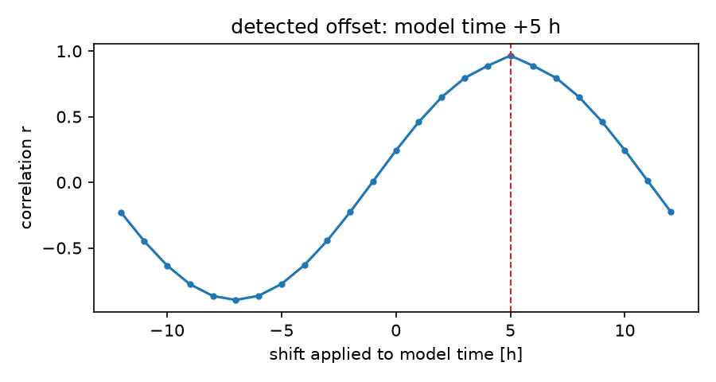
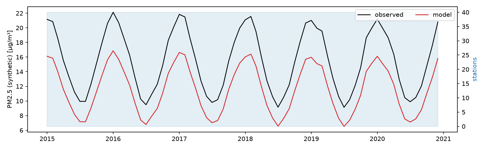
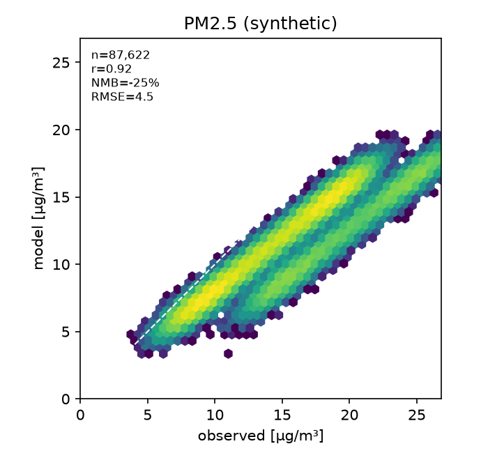
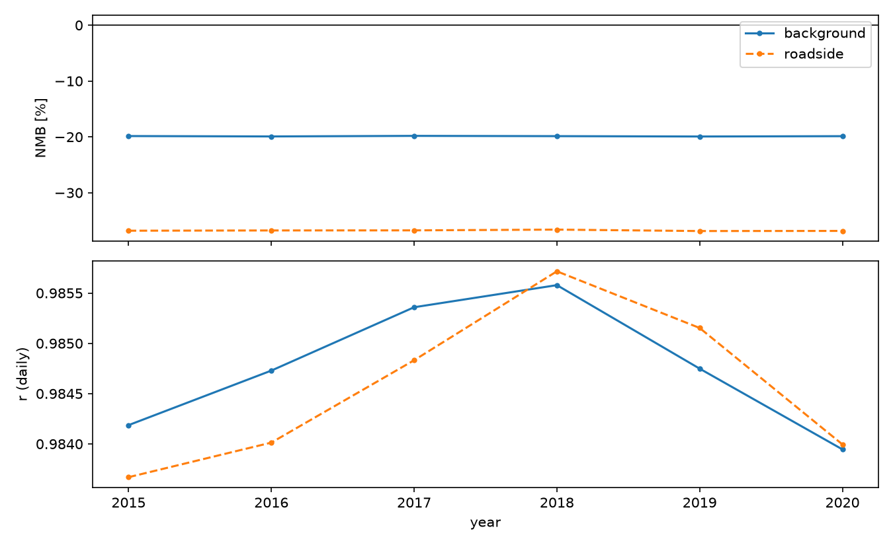

# air-quality-model-evaluation

[](https://github.com/tevet2005/air-quality-model-evaluation/actions/workflows/tests.yml)

**Check gridded air-quality model output against monitoring stations before using it as an exposure
estimate for health research.**

Chemical-transport models and reanalyses give pollutant concentrations everywhere, but they carry
systematic biases, and their files often use a different time convention from the monitors. This
toolkit turns raw monitoring tables and model grids into a reproducible evaluation: which grid cell each
monitor sits in, whether the clocks agree, and how large the bias is by station type, year and place.

It is one building block of a larger plan for a digital twin of air pollution and health:
see the [research roadmap](docs/roadmap.md).

## What it does

| Step | Module | Details |
| --- | --- | --- |
| 1. Tidy the monitoring data | `aqeval.stations`, `aqeval.qc` | Wide hourly tables (day rows × 24 hour columns, sentinel codes) → one row per station and hour with an explicit `ok / missing / error` status; time-zone conversion, completeness, hour-ending-aware daily means |
| 2. Match monitors to the grid | `aqeval.gridmatch` | Lambert conformal and regular lat/lon grids, inside/outside flag, column/row and distance to the cell centre; no GIS dependency |
| 3. Check the clock | `aqeval.timelag` | Lag scan on the diurnal anomaly finds a constant time offset, such as model output in UTC read as local time |
| 4. Pair and score | `aqeval.evaluate` | Daily pairing with a minimum-hours rule; n, MB, NMB, RMSE and r overall or by any grouping (station type, year, fiscal year, season) |
| 5. Plot | `aqeval.plots` | Monthly series with station counts, density scatter, yearly bias by group, lag scan |
| 6. Keep a catalogue | `aqeval.catalog` | File manifests with SHA-256 and per-dataset coverage: first/last time, years, missing rate |

No region, network, model or study period is hard-coded: every function takes them as arguments.

## Demo on synthetic data

`examples/model_evaluation_demo.py` builds a fake network of 40 monitors and a fake model that runs
5 hours off the monitors' clock and underestimates concentrations, more strongly at roadside sites.
No real measurements are used.

```bash
pip install -e ".[plot]"
python examples/model_evaluation_demo.py docs/img
```

```
detected offset: +5 h
    n  obs_mean  mod_mean    MB  NMB_pct  RMSE    r
87622      15.5     11.57 -3.93   -25.33  4.54 0.92
```

| Time-offset detection | Monthly means |
| --- | --- |
|  |  |
| **Daily scatter** | **Bias by year and station type** |
|  |  |

## Usage

```python
from aqeval import catalog, evaluate, gridmatch, stations, timelag

# 1. monitoring tables -> tidy hourly table
fmt = stations.WideHourlyFormat(hour_columns=[f"h{i:02d}" for i in range(1, 25)],
                                date_columns=["year", "month", "day"],
                                id_columns=["station", "pollutant"],
                                status_codes={9999: "missing", 9997: "error"}, drop_codes=[9998])
obs = stations.to_long(raw_table, fmt)
catalog.coverage(obs, ["pollutant"], "time_start")        # period and missing rate

# 2. monitors -> grid cells
grid = gridmatch.LambertGrid(lat1=30, lat2=60, lon0=10, lat0=45,
                             x_orig=-150_000, y_orig=-120_000, cell=5_000, ncols=60, nrows=48)
sites = gridmatch.match(sites, grid)

# 3. time offset
lag = timelag.best_lag(obs_hourly_series, model_hourly_series)

# 4. daily pairs and statistics
pairs = evaluate.pair(evaluate.daily_from_hourly(obs, "station", "time_start", "value"),
                      evaluate.daily_from_hourly(model, "station", "time_start", "value"),
                      on=["station", "date"])
evaluate.summarize(pairs, by=["station_type"])
```

## Applied in research

Applied to a regional monitoring network (about 600 monitors, 12 years) and a regional
chemical-transport model, this workflow found a time-zone mismatch in the model output and showed a
systematic PM2.5 underestimate of about 20 % with a daily correlation of 0.80, and a much larger NO₂
underestimate at roadside monitors. The data sets themselves are not part of this repository.

## 概要（日本語）

大気質モデル（化学輸送モデル・再解析）の格子出力を、測定局の観測値で検証するためのツールキットです。
健康影響研究でモデル値を曝露量として使う前に、次のことを再現可能な形で確かめます。

1. 測定局の時間値を、欠測・異常の状態付きの縦長データに整える
2. 各測定局がモデルのどの格子に入るかを対応付ける
3. モデルと観測の時刻のずれ（タイムゾーンの違いなど）を、日内変動の形から検出する
4. 日平均でペアを作り、平均バイアス・NMB・RMSE・相関を局種別・年ごとに出す
5. 図と、データの出所・期間・欠測率の一覧を作る

研究で実際に使った結果（約600局・12年分）では、モデル出力の時刻のずれを見つけ、PM2.5の約20%の系統的な過小評価（日平均の相関0.80）を示しました。
研究全体の計画は [docs/roadmap.md](docs/roadmap.md) にあります。

## Development

```bash
pip install -e ".[dev]"
pytest
```

## License

MIT. See [LICENSE](LICENSE).
