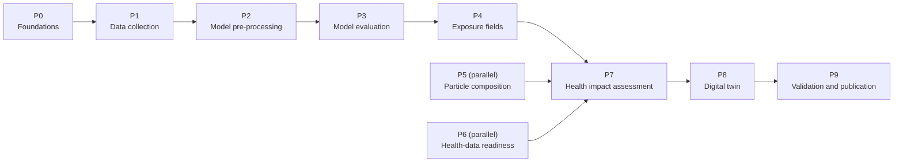

# Research roadmap: a digital twin of air pollution and health

**Goal.** Reconstruct, assess and predict the health impact of air pollution inside one system:

| Function | What it does | Question it answers |
| --- | --- | --- |
| **Reconstruct** | Pollutant concentrations for any day and place over two decades, with the matching changes in patient numbers | "What was happening that day, in that area?" |
| **Assess** | Exposure-response relationships (lags, sensitive groups) and the number of cases attributable to pollution | "How much do visits rise when PM2.5 rises by 10 µg/m³?" |
| **Predict and explore** | Health risk a few days ahead from forecasts; what-if scenarios such as emission cuts | "Should people take care tomorrow?" "What would a policy change achieve?" |

## Phases

| Phase | Content |
| --- | --- |
| P0 Foundations | Computing environment, open toolkit, reproducible pipelines |
| P1 Data collection | Long-term hourly monitoring data, model output, reanalysis, particle composition; provenance and missing-rate catalogue |
| P2 Model pre-processing | Monitor-to-grid matching, time-series extraction, time-zone alignment |
| P3 Model evaluation | Model and reanalysis against monitors by year, season, region and station type |
| P4 Exposure fields | Bias-corrected, spatially complete daily exposure combining monitors and models (kriging / machine learning), with uncertainty |
| P5 Particle composition | Long-term trends of metals and components; decide whether they enter the health model |
| P6 Health-data readiness | Ethics, data specification, pre-registered analysis plan, literature table, code tested on dummy data |
| P7 Health impact assessment | Time-series regression with distributed-lag non-linear models, multi-pollutant and stratified analyses, attributable cases |
| P8 Digital twin | Reconstruction, forecast and scenario modes on maps and time series |
| P9 Validation and publication | Hold-out validation, comparison with published estimates, papers |

## Principles

- Every number in the health module comes from checked literature or from the project's own fitted models.
- The open repository holds general-purpose tools only; study regions, data sets and any health data stay private.
- Each data set is catalogued with its source, checksum, period and missing rate before it is used.
